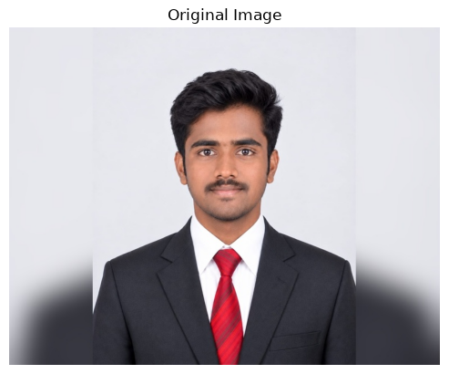
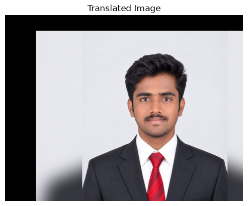
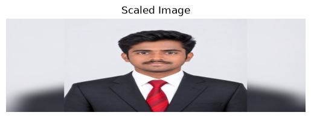
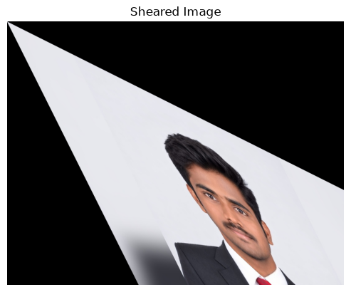
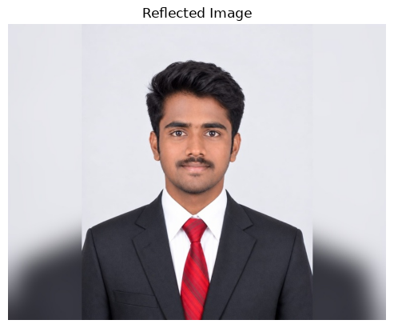
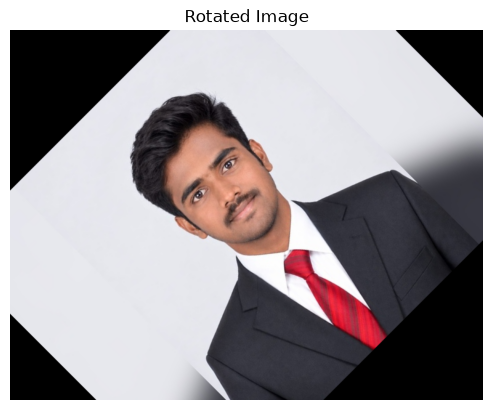
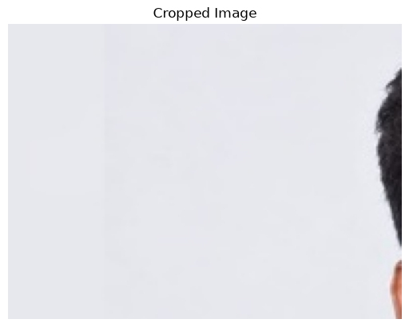

# EXPERIMENT 04: Record-Image Transformations

**Name:** MUTHUAKASH M

**Register Number:** 212225230194

---

## Aim

To perform basic image transformation operations such as translation, scaling, shearing, reflection, rotation, and cropping on an image using OpenCV, NumPy, and Matplotlib in Python.

---

## Software Required

- Python 3.x
- OpenCV (`opencv-python`)
- NumPy (`numpy`)
- Matplotlib (`matplotlib`)
- Jupyter Notebook / Google Colab / VS Code

---

## Input File Required

- `Qno. 1.jpg` – Input image used to perform the image transformations.

**Note:** Upload `Qno. 1.jpg` to this repository. The notebook loads the image using this filename.

---

## Algorithm

### 1. Import Libraries and Load the Image

1. Import the required libraries: `cv2`, `numpy`, and `matplotlib.pyplot`.
2. Read the input image using `cv2.imread('Qno. 1.jpg')`.
3. Convert the image from BGR to RGB using `cv2.cvtColor()` for correct display with Matplotlib.
4. Display the original image.

### 2. Image Translation

1. Set the horizontal translation value `tx = 100` and vertical translation value `ty = 50`.
2. Create a translation matrix using `np.float32()`.
3. Apply the translation using `cv2.warpAffine()`.
4. Display the translated image.

### 3. Image Scaling

1. Set the horizontal scaling factor `fx = 5.0` and vertical scaling factor `fy = 2.0`.
2. Resize the original image using `cv2.resize()`.
3. Use `cv2.INTER_LINEAR` interpolation for resizing.
4. Display the scaled image.

### 4. Image Shearing

1. Create a shearing matrix using `np.float32()`.
2. Set the horizontal and vertical shear factors to `0.5`.
3. Apply the transformation using `cv2.warpAffine()`.
4. Display the sheared image.

### 5. Image Reflection

1. Apply reflection to the original image using `cv2.flip()`.
2. Use the flip code `2` to flip the image horizontally.
3. Display the reflected image.

### 6. Image Rotation

1. Get the height and width of the original image.
2. Set the rotation angle to `45` degrees.
3. Calculate the center point of the image.
4. Create the rotation matrix using `cv2.getRotationMatrix2D()`.
5. Apply rotation using `cv2.warpAffine()`.
6. Display the rotated image.

### 7. Image Cropping

1. Set the starting coordinates as `x = 100` and `y = 100`.
2. Set the crop width to `200` pixels and height to `150` pixels.
3. Crop the image using NumPy array slicing.
4. Display the cropped image.

---

## Program

### 1. Import Libraries and Load the Image

```python
import cv2
import numpy as np
import matplotlib.pyplot as plt

# Step 1: Load the image
image = cv2.imread('Qno. 1.jpg')

# Display the original image
plt.imshow(cv2.cvtColor(image, cv2.COLOR_BGR2RGB))
plt.title("Original Image")
plt.axis('off')
```




### 2. Image Translation

```python
# Step 2: Image Translation
tx, ty = 100, 50

M_translation = np.float32([
    [1, 0, tx],
    [0, 1, ty]
])

translated_image = cv2.warpAffine(
    image,
    M_translation,
    (image.shape[1], image.shape[0])
)

plt.imshow(cv2.cvtColor(translated_image, cv2.COLOR_BGR2RGB))
plt.title("Translated Image")
plt.axis('off')
```




### 3. Image Scaling

```python
# Step 3: Image Scaling
fx, fy = 5.0, 2.0

scaled_image = cv2.resize(
    image,
    None,
    fx=fx,
    fy=fy,
    interpolation=cv2.INTER_LINEAR
)

plt.imshow(cv2.cvtColor(scaled_image, cv2.COLOR_BGR2RGB))
plt.title("Scaled Image")
plt.axis('off')
```




### 4. Image Shearing

```python
# Step 4: Image Shearing
shear_matrix = np.float32([
    [1, 0.5, 0],
    [0.5, 1, 0]
])

sheared_image = cv2.warpAffine(
    image,
    shear_matrix,
    (image.shape[1], image.shape[0])
)

plt.imshow(cv2.cvtColor(sheared_image, cv2.COLOR_BGR2RGB))
plt.title("Sheared Image")
plt.axis('off')
```




### 5. Image Reflection

```python
# Step 5: Image Reflection
reflected_image = cv2.flip(image, 2)

plt.imshow(cv2.cvtColor(reflected_image, cv2.COLOR_BGR2RGB))
plt.title("Reflected Image")
plt.axis('off')
```




### 6. Image Rotation

```python
# Step 6: Image Rotation
(height, width) = image.shape[:2]

angle = 45
center = (width // 2, height // 2)

M_rotation = cv2.getRotationMatrix2D(center, angle, 1)

rotated_image = cv2.warpAffine(
    image,
    M_rotation,
    (width, height)
)

plt.imshow(cv2.cvtColor(rotated_image, cv2.COLOR_BGR2RGB))
plt.title("Rotated Image")
plt.axis('off')
```



### 7. Image Cropping

```python
# Step 7: Image Cropping
x, y, w, h = 100, 100, 200, 150

cropped_image = image[y:y+h, x:x+w]

plt.imshow(cv2.cvtColor(cropped_image, cv2.COLOR_BGR2RGB))
plt.title("Cropped Image")
plt.axis('off')
```


---

## Result

Thus, image transformation operations including translation, scaling, shearing, reflection, rotation, and cropping were performed successfully on the input image using OpenCV, NumPy, and Matplotlib.
